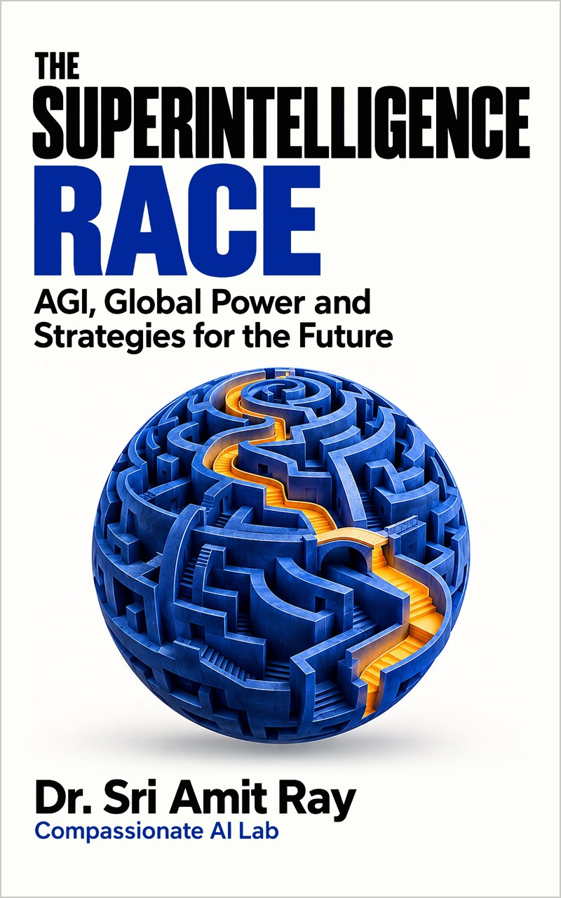

# The Superintelligence Race: companion code



Companion programs, notebook and workbooks for the book **The Superintelligence Race: AGI, Global Power and Strategies for the Future** by Dr. Sri Amit Ray ([Compassionate AI Lab](https://amitray.com/compassionate-ai-lab/), First Edition, 2026; ISBN 978-81-69641-38-8).

[](https://colab.research.google.com/github/compassionate-ai-lab/superintelligence-race/blob/main/notebooks/AGI_Companion_Colab.ipynb)

### Why the superintelligence race needs strategy, not prediction

Laboratories are racing one another for capability, and nations for compute, talent and strategic advantage. Yet no one knows when, or whether, artificial general intelligence will arrive. Credible forecasts on record range from a few years to several decades, and the people who must decide now (governments, boards, regulators, universities and families) cannot wait for the argument to be settled. The useful question is not *when* AGI arrives but *what we permit AI systems to do, and who answers when they do it*.

The book's organizing argument separates three things that are usually blurred. **Capability** is what an AI system can do. **Authority** is what it is permitted to do, by whom and within what limits. **Accountability** is who answers when it acts, and how its actions can be challenged, corrected and repaired. Many of the failures in the book's cases come from authority running ahead of demonstrated capability, or from accountability too weak to find, answer for and repair what went wrong.

That argument has arithmetic behind it. A review team can oversee only so many delegated actions before its queue grows without limit; a system that improves itself can approach a capability boundary faster than people can evaluate, authorize and act; a check that shares a cause of failure with the thing it checks protects far less than it appears to. The book makes each of these mechanisms precise enough to support a decision, and this repository lets readers rerun every number and change every assumption.

*In the book:* the 2026 baseline and its evidence ladder (Chapter 2); deciding under deep uncertainty with minimax regret and signposts (Chapter 3); agents and autonomous organizations (Chapter 5); automated science and recursive improvement (Chapter 6); the safety science and the release decision (Chapter 10); compute sovereignty (Chapter 12); verification and deterrence (Chapter 14); work and careers to 2040 (Chapter 16); democracy and AI companions (Chapter 18); boards and national strategy (Chapters 19–20); an International AGI Agency (Chapter 21); law and accountability (Chapter 22); scenarios to 2050 (Chapter 23); and compassionate superintelligence (Chapter 24).

### What the book provides

[*The Superintelligence Race*](https://amitray.com/the-superintelligence-race-ebook/) turns the race from a forecast into a set of decisions that can be tested:

- **Twenty-four chapters in six parts**: the strategic landscape; technology trajectories to 2050; power and geopolitics; economy and society; governance; futures and choices.
- **Dr. Ray's six named protocols**: the Safe RSI Protocol, the Alignment Protocol, the Decentralised Compute Survival Strategy, the AGI-Proof Career Framework, the 7-Step AGI-Resistant Architecture Protocol and the 30-Day AGI Resilience Programme.
- **Twenty strategic tools** and two decision sheets (the Scenario Workbook and the Compassionate Decision Record), reproduced as worksheets in the Companion Workbook.
- **Six model families (M1–M6)** in Appendix F: the governance-capacity boundary, the intervention margin, dependency and common-cause failure, robust compute allocation, minimax regret and timing, and floors with lexicographic comparison.
- **One consolidated worked record** (a hospital discharge agent, Chapter 20) and one genuinely hard compassionate decision (the Heatwave Night, Chapter 24), each with every figure reproduced here.

### How it delivers it

Every model-derived number in the book is produced by the code in this repository and checked by its tests, so readers can rerun, change and extend each example rather than take it on trust. The same code is attached inside the book's PDF edition; its SHA-256 checksum is printed on the copyright page and in Appendix F, and `Companion_SHA256.txt` records the release file that matches the printed checksum.

## Run it

```sh
python -m agi_models.run_all                 # prints every worked number in the book
python -m unittest discover -s tests -v      # 10 tests: worked numbers, units, limiting cases, review corrections
python tests/test_models.py                  # the same tests without unittest
```

Python 3.9 or later; standard library only. `expected_output.txt` is the output of the first command and `TEST_RESULTS.txt` the output of the second.

**In Google Colab:** use the *Open in Colab* button above, or upload `notebooks/AGI_Companion_Colab.ipynb` with **File > Upload notebook**. The notebook carries its own copy of the code, checks it against the checksum printed in the book, reproduces every number, runs the tests and adds interactive charts for M1, M2 and M5. It needs no other files.

## What the program computes

| Book | Module and function(s) | Main result |
|---|---|---|
| Ch 1, App F (M1) | `m1_governance.Oversight` | 15 reviewers at 6 careful reviews an hour, 8 hours a day, with 7% of 10,000 daily actions needing review: utilization 0.972; at a planning utilization of 0.8 the team can oversee 8,229 actions a day; doubling deployment adds a backlog of 85 reviews an hour (680 a day); better verification (3% review) lifts the boundary to 19,200 |
| Ch 2 | `worked_numbers.ch02_*` | AI saves time only if its success rate exceeds (v + r)/(1 + r): 0.42 with cheap verification, where 66% success saves 29% of the time; with costly checking and rework (v = 0.5, r = 0.4, s = 0.5) the same arithmetic gives a 20% slowdown |
| Ch 3, App F (M5) | `m5_regret` | largest regrets 14, 6, 18 and 3: the staged strategy is the minimax-regret choice; the big bet has the lower expected loss only if P(fast) > 8/11 ≈ 0.73; a signpost response is timely if W ≥ L − P |
| Ch 4 | `worked_numbers.ch04_growth` | physical compute growth limited to 1.61× a year by power and efficiency (chips allow 1.8×); with algorithms halving cost every 8 months, effective growth about 4.6× a year; 4.0× if power does not grow; 2.7× if algorithmic progress halves |
| Ch 5 | `worked_numbers.ch05_harm` | customs clearance: $10.90 per consignment autonomous against $237 supervised; supervision is better only if the autonomous error rate exceeds 11.8% |
| Ch 6, App F (M2) | `m2_intervention` | with 13 points of margin above the reserve and a closing rate of 0.75 points a day, evaluations must come at least every 17.3 days, or 14.6 days if the rate doubles monthly; a correction applied 3 cycles late makes a stable loop unstable unless the correction is gentler |
| Ch 7 | `worked_numbers.ch07_delay_cost` | a further two-year trial of robotic first entry in mines would cost about 28 lives, or 14 if the benefit were half as large |
| Ch 8 | `worked_numbers.ch08_rebound` | if efficiency doubles, total energy falls 19% when demand is inelastic (ε = 0.7) but rises 41% when it is elastic (ε = 1.5) |
| Ch 10 | `worked_numbers.ch10_*` | two independent samples of 1,800: 52 against 14 omissions, z ≈ 4.7; after 21,400 incident-free bookings the 95% upper bound on the severe-error rate is about 0.014% |
| Ch 11 | `worked_numbers.ch11_leontief` | compute for 100 functions, talent for 40, institutions for 30: the country can deploy 30; more compute changes nothing, stronger institutions raise it to 40 |
| Ch 12, App F (M4) | `m4_compute.solve`, `m4_compute.continuous_optimum` | with capacity bought in blocks of 10: protection costs 100 (normal only), 230 (70 foreign + 100 regional, four scenarios) and 320 (70 foreign + 100 sovereign, all five); without blocks, 226⅔ and 316⅔ |
| App F (M3) | `m3_dependency` | a 20-step chain at 0.98 a step succeeds only 67% of the time; two checks that each fail 5% fail together 0.25% of the time if independent, but 1.16% with a common-cause fraction of 0.2 |
| Ch 14 | `worked_numbers.ch14_detection` | independent detection layers: 32% in the failed pilot, 85% after adding per-run notification and chip-level attestation |
| Ch 15 | `worked_numbers.ch15_*` | if 60% of tasks become ten times cheaper, output rises at most 2.2× (2.5× if they became free; 5.3× if 90% of tasks change) |
| Ch 16 | `worked_numbers.ch16_regret` | career paths compared by regret across scenarios: domain expertise plus evaluation plus an anchored, accountable role is the robust choice |
| Ch 17 | `worked_numbers.ch17_reach` | a compute dividend with 82% coverage but low adequacy reaches 0.19 of the burden; the redesign reaches 0.97 |
| Ch 19 | `worked_numbers.ch19_capacity` | 40 evaluators can complete 192 thorough evaluations a year against 600 systems; tiering cuts demand to 141 evaluation-equivalents |
| Ch 20 | `cases.hospital_derived` | the hospital discharge agent: 22.9% shorter discharge delay in the pilot against 3.2% in comparison wards (19.8 points attributable); 105 agent errors, 67 caught by nurses; containment 45 minutes after detection |
| Ch 21 | `worked_numbers.ch21_deterrence` | a pacing agreement holds only if detection × penalty ≥ gain: 0.32 × 20 = 6.4 < 10 fails, 0.85 × 20 = 17 holds |
| Ch 24, App F (M6) | `m6_compassion` | the Heatwave Night: 1,450 MW of relief for four hours (5,800 MWh); only the hybrid options meet every floor; residential-only rotation leaves 3.45 million people without power at once |

The inputs are illustrative values chosen so every step can be checked by hand. They describe no real organization or city. Replace them with values from your own situation, and add a test for each case you rely on.

## Repository contents

| Path | Contents |
|---|---|
| `agi_models/` | the six model families, the chapters' other worked calculations, the hospital case ledger and `run_all.py` |
| `tests/test_models.py` | 10 tests |
| `notebooks/AGI_Companion_Colab.ipynb` | self-contained Colab notebook |
| `workbook/` | the Companion Workbook: printable colour and black-and-white PDFs (US Letter) and an editable Word file |
| `expected_output.txt`, `TEST_RESULTS.txt` | reference output and test log for this release |
| `Companion_SHA256.txt` | the release file and checksum printed in the book |
| `.github/workflows/tests.yml` | runs the tests on Python 3.9 to 3.13 at every push |

## Get the book

- Full-color PDF eBook, with this code and the workbooks attached: [amitray.com/the-superintelligence-race-ebook](https://amitray.com/the-superintelligence-race-ebook/)
- Kindle and paperback availability: consult the book page for current publication links.
- Related companion code: [compassionate-ai-lab/ahimsa-in-agentic-ai](https://github.com/compassionate-ai-lab/ahimsa-in-agentic-ai) and [compassionate-ai-lab/no-harm-principles](https://github.com/compassionate-ai-lab/no-harm-principles)

## Related published books

1. Ray, Amit. *Human-Centered Compassionate AI*. Compassionate AI Lab, 2026. ISBN: 978-8169641050.
2. Ray, Amit. *Compassionate Artificial Intelligence: Frameworks and Algorithms*. Compassionate AI Lab, 2018. ISBN: 978-9382123460.
3. Ray, Amit. *Compassionate Artificial Superintelligence AI 5.0*. Compassionate AI Lab, 2018. ISBN: 978-9382123446.
4. Ray, Sri Amit. *Compassionate Superintelligence: Architecture, Alignment, and the Future of Intelligence That Cares*. 2nd ed., Compassionate AI Lab, 2026. ISBN 978-81-69641-22-7.
5. Ray, Sri Amit. *Ahimsa in Agentic AI: Algorithmic Non-Violence and the Architecture of Compassionate Code*. Compassionate AI Lab, 2026. ISBN 978-81-69641-29-6. Companion code: <https://github.com/compassionate-ai-lab/ahimsa-in-agentic-ai>
6. Ray, Sri Amit. *No-Harm Principles in AI Architectures: Ahimsa-Driven Multi-Agent AI Systems*. Compassionate AI Lab, 2026. ISBN 978-81-69641-30-2. Companion code: <https://github.com/compassionate-ai-lab/no-harm-principles>

## Compassionate AI Key Articles

Articles by Dr. Sri Amit Ray that develop the compassionate-AI, ethics and governance frameworks the book builds on (the Compassionate AI Architecture, the Compassion Quotient, CHFOA, AI companions, agentic AI ethics and AI-driven democracy), from the most recent:

- Ray, Amit. "The Ethics of Agentic AI: Accountability, Consent and Human Oversight When AI Acts for Us." *Compassionate AI*, 3.10 (2026): 18–20. [https://amitray.com/ethics-of-agentic-ai-accountability-oversight/](https://amitray.com/ethics-of-agentic-ai-accountability-oversight/)
- Ray, Amit. "AI Companions and the Human Heart: An Ethical Framework for Emotional AI, Loneliness and Children (2026)." *Compassionate AI*, 3.10 (2026): 18–20. [https://amitray.com/ai-companions-ethics-emotional-dependency/](https://amitray.com/ai-companions-ethics-emotional-dependency/)
- Ray, Amit. "The Top 12 LLM Benchmarks in 2026: A Complete Guide to Evaluating Large Language Models." *Compassionate AI*, 3.10 (2026): 1–5. [https://amitray.com/top-12-llm-benchmarks/](https://amitray.com/top-12-llm-benchmarks/)
- Ray, Amit. "Can Quantum AI Become Conscious? The Sri Amit Ray Framework for Spontaneous Machine Awareness." *Compassionate AI*, 3.9 (2026): 30–32. [https://amitray.com/can-quantum-ai-become-conscious-spontaneous-machine-awareness/](https://amitray.com/can-quantum-ai-become-conscious-spontaneous-machine-awareness/)
- Ray, Amit. "Heart Disease Prevention with Agentic AI: Tools, Techniques, Mathematical Models, and AI Architectures." *Compassionate AI*, 3.8 (2026): 78–80. [https://amitray.com/heart-disease-prevention-agentic-ai/](https://amitray.com/heart-disease-prevention-agentic-ai/)
- Ray, Amit. "Compassionate AI in Health Care: A Comprehensive Review (2026)." *Compassionate AI*, 3.8 (2026): 63–74. [https://amitray.com/compassionate-ai-in-health-care-a-comprehensive-review/](https://amitray.com/compassionate-ai-in-health-care-a-comprehensive-review/)
- Ray, Amit. "The 25 Algorithms of the Sri Amit Ray Compassionate AI Architecture." *Compassionate AI*, 3.8 (2026): 63–65. [https://amitray.com/ray-25-compassionate-ai-algorithms/](https://amitray.com/ray-25-compassionate-ai-algorithms/)
- Ray, Amit. "Human-AI Emotional Resonance Algorithm: Ethical Emotional Co-Regulation in the Sri Amit Ray Compassionate AI Architecture (CAIA)." *Compassionate AI*, 2.6 (2026): 81–83. [https://amitray.com/human-ai-emotional-resonance-algorithm-compassionate-ai/](https://amitray.com/human-ai-emotional-resonance-algorithm-compassionate-ai/)
- Ray, Amit. "Build Your Own Agentic AI Healthcare MCP Server: A Complete Guide to AI-Powered Healthcare Agents." *Compassionate AI*, 3.8 (2026): 60–62. [https://amitray.com/agentic-ai-healthcare-mcp-server/](https://amitray.com/agentic-ai-healthcare-mcp-server/)
- Ray, Amit. "Medical AI Drones for Disaster Management: Intelligent Unmanned Health-Care Systems." *Compassionate AI*, 3.8 (2026): 57–59. [https://amitray.com/medical-ai-drones-for-disaster-management/](https://amitray.com/medical-ai-drones-for-disaster-management/)
- Ray, Amit. "Compassionate Medical AI Drones as Intelligent Unmanned Health-Care Systems: A Human-Centered AI Architecture for Suffering Reduction and Human Flourishing." *Compassionate AI*, 3.8 (2026): 57–59. [https://amitray.com/medical-ai-drones-human-centered-ai-healthcare/](https://amitray.com/medical-ai-drones-human-centered-ai-healthcare/)
- Ray, Amit. "The Sri Amit Ray Compassion Quotient (CQ) Algorithm for Compassionate AI." *Compassionate AI*, 2.6 (2026): 81–83. [https://amitray.com/compassion-quotient-cq-algorithm-compassionate-ai/](https://amitray.com/compassion-quotient-cq-algorithm-compassionate-ai/)
- Ray, Amit. "Collective Human Flourishing Optimization AI Algorithm (CHFOA): A Compassion-Centered Multi-Stakeholder AI Optimization Framework." *Compassionate AI*, 2.6 (2026): 90–92. [https://amitray.com/collective-human-flourishing-optimization-algorithm-chfoa/](https://amitray.com/collective-human-flourishing-optimization-algorithm-chfoa/)
- Ray, Amit. "Human Flourishing Optimization Algorithm (HFOA) for Compassionate AI Architecture." *Compassionate AI*, 2.6 (2026): 81–83. [https://amitray.com/human-flourishing-optimization-algorithm-hfoa-compassionate-ai/](https://amitray.com/human-flourishing-optimization-algorithm-hfoa-compassionate-ai/)
- Ray, Amit. "The Sri Amit Ray Compassionate AI Architecture (CAIA): A Seven-Layer Framework for Human-Centered Artificial Intelligence." *Compassionate AI*, 2.6 (2026): 81–83. [https://amitray.com/compassionate-ai-architecture/](https://amitray.com/compassionate-ai-architecture/)
- Ray, Amit. "Human-Centered Compassionate AI: The 25 Algorithms for Protecting Humanity and Future Generations." *Compassionate AI*, 2.6 (2026): 30–32. [https://amitray.com/human-centered-compassionate-ai-the-25-algorithms/](https://amitray.com/human-centered-compassionate-ai-the-25-algorithms/)
- Ray, Amit. "AI Consciousness and Self-Aware Robots: Sri Amit Ray’s Framework for Compassionate Intelligence." *Compassionate AI*, 2.5 (2026): 57–59. [https://amitray.com/ai-consciousness-self-aware-robots/](https://amitray.com/ai-consciousness-self-aware-robots/)
- Ray, Amit. "The 12 Sri Amit Ray Compassionate AI Principles | Ethical AI Framework." *Compassionate AI*, 2.4 (2026): 12–14. [https://amitray.com/the-12-compassionate-ai-principles-for-humanity-and-future-generations/](https://amitray.com/the-12-compassionate-ai-principles-for-humanity-and-future-generations/)
- Ray, Amit. "The Compassionate AI Lab Declaration on AI Safety, Suffering Reduction, and the Protection of Humanity." *Compassionate AI*, 4.12 (2025): 72–74. [https://amitray.com/compassionate-ai-declaration-protection-of-humanity/](https://amitray.com/compassionate-ai-declaration-protection-of-humanity/)
- Ray, Amit. "Compassionate AI for Forward Deployed Engineers (FDEs) in SaaS Companies." *Compassionate AI*, 4.11 (2025): 15–17. [https://amitray.com/compassionate-ai-for-forward-deployed-engineers-fdes-in-saas-companies/](https://amitray.com/compassionate-ai-for-forward-deployed-engineers-fdes-in-saas-companies/)
- Ray, Amit. "Microbial AI, Bioleaching and Digital Twins for Manufacturing the 17 Rare Earth Elements." *Compassionate AI*, 4.10 (2025): 42–44. [https://amitray.com/microbial-ai-bioleaching-and-digital-twins-for-manufacturing-the-17-rare-earth-elements/](https://amitray.com/microbial-ai-bioleaching-and-digital-twins-for-manufacturing-the-17-rare-earth-elements/)
- Ray, Amit. "AI-Driven Rare Earth Element Magnet Design: Detailed Methodologies." *Compassionate AI*, 4.10 (2025): 27–29. [https://amitray.com/ai-driven-rare-earth-elements-magnet-design-methodologies/](https://amitray.com/ai-driven-rare-earth-elements-magnet-design-methodologies/)
- Ray, Amit. "AI Agents and Robots in Peacekeeping Force and Social Care: Compassionate AI Technologies." *Compassionate AI*, 3.9 (2025): 75–77. [https://amitray.com/ai-agents-robots-peacekeeping-force-social-care-compassionate-ai/](https://amitray.com/ai-agents-robots-peacekeeping-force-social-care-compassionate-ai/)
- Ray, Amit. "Ray Mother–Infant Inter-brain Synchrony Algorithm for Deep Compassionate AI." *Compassionate AI*, 3.9 (2025): 60–62. [https://amitray.com/ray-mother-infant-inter-brain-synchrony-algorithm-deep-compassionate-ai/](https://amitray.com/ray-mother-infant-inter-brain-synchrony-algorithm-deep-compassionate-ai/)
- Ray, Amit. "Pain Recognition and Prediction AI Algorithm (PRPA) for Compassionate AI." *Compassionate AI*, 3.9 (2025): 60–62. [https://amitray.com/pain-recognition-and-prediction-algorithm-prpa-for-compassionate-ai/](https://amitray.com/pain-recognition-and-prediction-algorithm-prpa-for-compassionate-ai/)
- Ray, Amit. "Modeling Consciousness in Compassionate AI: Transformer Models and EEG Data Verification." *Compassionate AI*, 3.9 (2025): 27–29. [https://amitray.com/modeling-consciousness-in-compassionate-ai-transformer-models/](https://amitray.com/modeling-consciousness-in-compassionate-ai-transformer-models/)
- Ray, Amit. "The 7 Pillars of Compassionate AI Democracy." *Compassionate AI*, 3.9 (2024): 84–86. [https://amitray.com/the-7-pillars-of-compassionate-ai-democracy/](https://amitray.com/the-7-pillars-of-compassionate-ai-democracy/)
- Ray, Amit. "Compassionate AI-Driven Democracy: Power and Challenges." *Compassionate AI*, 3.9 (2024): 48–50. [https://amitray.com/compassionate-ai-driven-democracy-power-and-challenges/](https://amitray.com/compassionate-ai-driven-democracy-power-and-challenges/)
- Ray, Amit. "The 10 Ethical AI Indexes for LLM Data Training and Responsible AI." *Compassionate AI*, 3.8 (2023): 35–39. [https://amitray.com/the-10-ethical-ai-indexes-for-responsible-ai/](https://amitray.com/the-10-ethical-ai-indexes-for-responsible-ai/)
- Ray, Amit. "Ethical Responsibilities in Large Language AI Models: GPT-3, GPT-4, PaLM 2, LLaMA, Chinchilla, Gopher, and BLOOM." *Compassionate AI*, 3.7 (2023): 21–23. [https://amitray.com/ethical-responsibility-in-large-language-ai-models/](https://amitray.com/ethical-responsibility-in-large-language-ai-models/)
- Ray, Amit. "Calling for a Compassionate AI Movement: Towards Compassionate Artificial Intelligence." *Compassionate AI*, 2.6 (2023): 75–77. [https://amitray.com/calling-for-a-compassionate-ai-movement/](https://amitray.com/calling-for-a-compassionate-ai-movement/)
- Ray, Amit. "From Data-Driven AI to Compassionate AI: Safeguarding Humanity and Empowering Future Generations." *Compassionate AI*, 2.6 (2023): 51–53. [https://amitray.com/from-data-driven-ai-to-compassionate-ai-safeguarding-humanity-and-empowering-future-generations/](https://amitray.com/from-data-driven-ai-to-compassionate-ai-safeguarding-humanity-and-empowering-future-generations/)
- Ray, Amit. "Artificial intelligence for Climate Change, Biodiversity and Earth System Models." *Compassionate AI*, 1.1 (2022): 54–56. [https://amitray.com/artificial-intelligence-for-climate-change-and-earth-system-models/](https://amitray.com/artificial-intelligence-for-climate-change-and-earth-system-models/)
- Ray, Amit. "Artificial Intelligence for Balance Control and Fall Detection of Elderly People." *Compassionate AI*, 4.10 (2018): 39–41. [https://amitray.com/artificial-intelligence-for-balance-control-and-fall-detection-system-of-elderly-people/](https://amitray.com/artificial-intelligence-for-balance-control-and-fall-detection-system-of-elderly-people/)
- Ray, Amit. "Artificial Intelligence to Combat Antibiotic Resistant Bacteria." *Compassionate AI*, 2.6 (2018): 3–5. [https://amitray.com/artificial-intelligence-for-antibiotic-resistant-bacteria/](https://amitray.com/artificial-intelligence-for-antibiotic-resistant-bacteria/)
- Ray, Amit. "Navigation System for Blind People Using Artificial Intelligence." *Compassionate AI*, 2.5 (2018): 42–44. [https://amitray.com/artificial-intelligence-for-assisting-blind-people/](https://amitray.com/artificial-intelligence-for-assisting-blind-people/)
- Ray, Amit. "Brain-Computer Interface and Compassionate Artificial Intelligence." *Compassionate AI*, 2.5 (2018): 3–5. [https://amitray.com/brain-computer-interface-compassionate-ai/](https://amitray.com/brain-computer-interface-compassionate-ai/)


## Cite as

**Book (MLA):**
Ray, Sri Amit. *The Superintelligence Race: AGI, Global Power and Strategies for the Future*. Compassionate AI Lab, 2026. ISBN 978-81-69641-38-8.

**Book (APA):**
Ray, S. A. (2026). *The superintelligence race: AGI, global power and strategies for the future*. Compassionate AI Lab.

**Companion code:**
Ray, S. A. (2026). *The Superintelligence Race: companion code* (Version 1.3.0) [Computer software]. Compassionate AI Lab. https://github.com/compassionate-ai-lab/superintelligence-race

**BibTeX:**

```bibtex
@book{ray2026race,
  author    = {Ray, Sri Amit},
  title     = {The Superintelligence Race: AGI, Global Power and Strategies for the Future},
  publisher = {Compassionate AI Lab},
  year      = {2026},
  isbn      = {978-81-69641-38-8},
  url       = {https://github.com/compassionate-ai-lab/superintelligence-race}
}
```

GitHub's **Cite this repository** button (from `CITATION.cff`) gives the same reference in APA and BibTeX.

## Corrections and validation - 28 October 2026

This release (companion version 1.3.0) matches the 414-page full-color PDF eBook of *The Superintelligence Race* (ISBN 978-81-69641-37-1) after its final review.

- Chapter 12 and Appendix F state that compute capacity is contracted in blocks of 10 units, which the search in `m4_compute.solve` assumes; `m4_compute.continuous_optimum` gives the exact optimum without blocks (66⅔ + 100, costs 226⅔ and 316⅔), and a test checks it in exact fractions.
- Chapter 10's warning-sign evidence is defined as two independent samples of 1,800, matching the two-proportion test.
- Chapter 18 states the full stability condition of the dependence model, 0 ≤ 1 + αγ − βH < 1.
- `run_all` prints at 12 significant digits, so its output is identical on every supported Python version.

Validation: 10 tests passed under Python 3.9, 3.11, 3.12 and 3.13, and the program's output matches `expected_output.txt`. Every model-derived number printed in the book was found in that output. These checks cover the teaching examples and stated regression cases; they are not evidence about any real system.

Please report errors through the repository's Issues page.

## Licence

The code in this repository is released under the MIT License (see `LICENSE`). The text of the book and the Companion Workbook are © 2026 Dr. Sri Amit Ray, all rights reserved; purchasers may reproduce the worksheets for their own use and within their organizations.

About the lab: [Compassionate AI Lab](https://amitray.com/compassionate-ai-lab/) · More of the author's work: https://amitray.com
